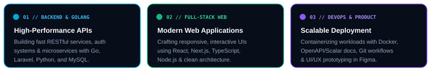
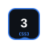
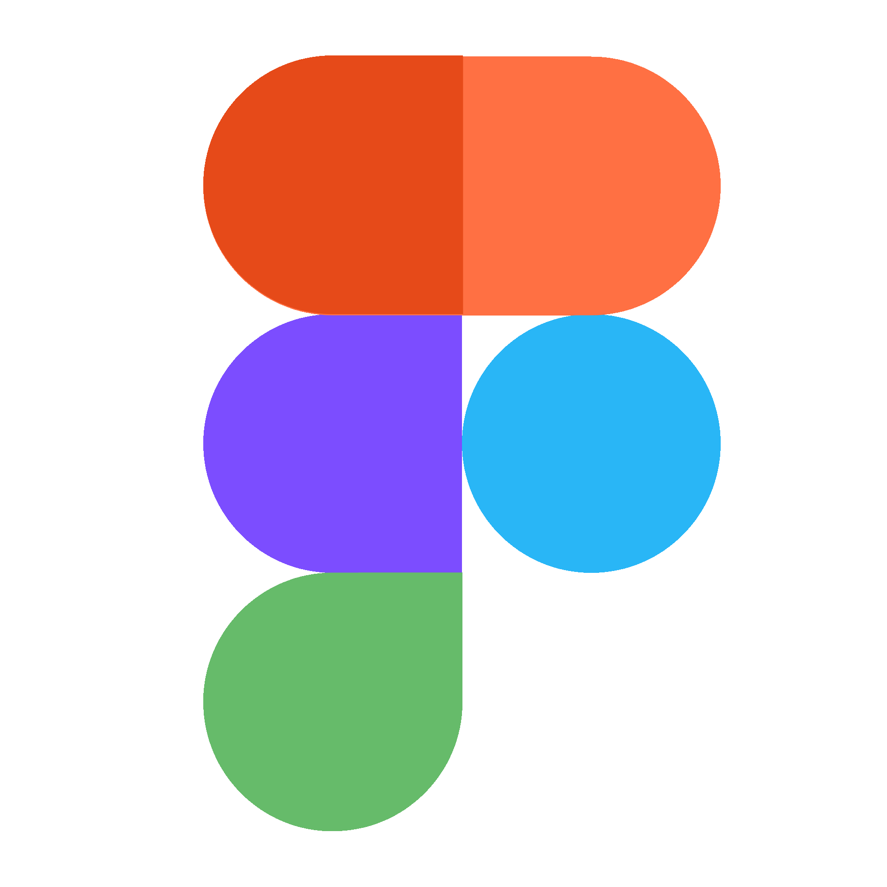
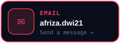
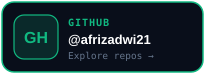

<div align="center">
  
</div>

<br/>

<p align="center">
  
</p>

<p align="center">
  <a href="https://github.com/afrizadwi21">
    
  </a>
  
  
  
</p>

---

## ⚡ `whoami` — About Me

```typescript
const afriza = {
  name: "M. Afriza Dwi I",
  role: "Web Developer Student",
  school: "SMK Negeri 4 Padalarang (2024 — Present)",
  major: "Software & Game Development (PPLG / RPL)",
  currentlyBuilding: "AI-powered apps & web projects",
  currentMission: "Becoming a Full-Stack Developer",
  currentlyLearning: ["Next.js", "TypeScript", "Go", "Docker"],
  techIEnjoy: ["Laravel", "React.js", "JavaScript", "PHP"],
};
```

<div align="center">
  
</div>

---

## 🛠️ Animated Tech Arsenal & Hard Skills

<div align="center">

<table>
    <tr>
        <td align="center" width="96">
            <br>
            <b>JavaScript</b>
        </td>
        <td align="center" width="96">
            <br>
            <b>TypeScript</b>
        </td>
        <td align="center" width="96">
            <br>
            <b>React</b>
        </td>
        <td align="center" width="96">
            <br>
            <b>Next.js</b>
        </td>
        <td align="center" width="96">
            <br>
            <b>Node.js</b>
        </td>
        <td align="center" width="96">
            <br>
            <b>PHP</b>
        </td>
        <td align="center" width="96">
            <br>
            <b>Laravel</b>
        </td>
        <td align="center" width="96">
            <br>
            <b>Go</b>
        </td>
    </tr>
    <tr>
        <td align="center" width="96">
            <br>
            <b>HTML5</b>
        </td>
        <td align="center" width="96">
            <br>
            <b>CSS3</b>
        </td>
        <td align="center" width="96">
            <br>
            <b>MySQL</b>
        </td>
        <td align="center" width="96">
            <br>
            <b>Python</b>
        </td>
        <td align="center" width="96">
            <br>
            <b>REST API</b>
        </td>
        <td align="center" width="96">
            <br>
            <b>Docker</b>
        </td>
        <td align="center" width="96">
            <br>
            <b>Figma</b>
        </td>
        <td align="center" width="96">
            <br>
            <b>GitHub</b>
        </td>
    </tr>
</table>

</div>

---

## 📊 GitHub Telemetry & Analytics

<div align="center">
  
  
</div>

<div align="center">
  
</div>

<div align="center">
  
</div>

---

## 🌐 Connect & Reach Me

<div align="center">
  <a href="mailto:afriza.dwi21@gmail.com">
    
  </a>
  &nbsp;
  <a href="https://instagram.com/dw_afrizaaa" target="_blank">
    
  </a>
  &nbsp;
  <a href="https://linkedin.com/in/afrizadwi" target="_blank">
    
  </a>
  &nbsp;
  <a href="https://github.com/afrizadwi21" target="_blank">
    
  </a>
</div>

<br/>

<p align="center">
  
</p>
